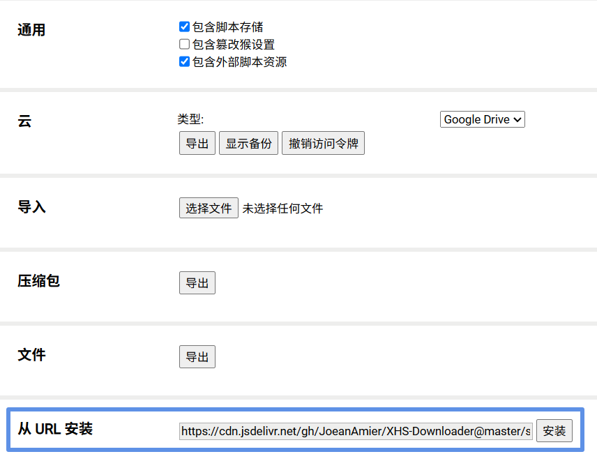
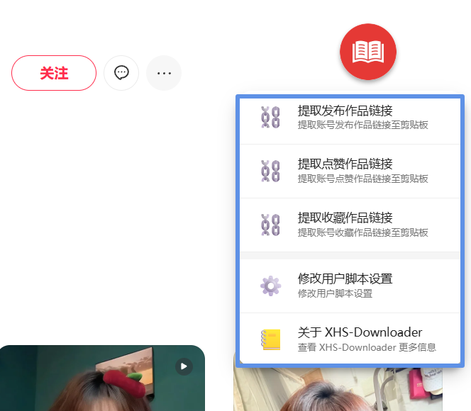
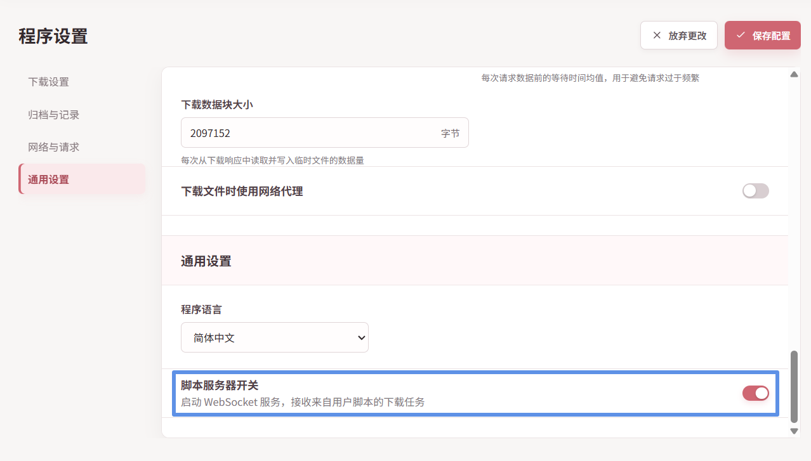
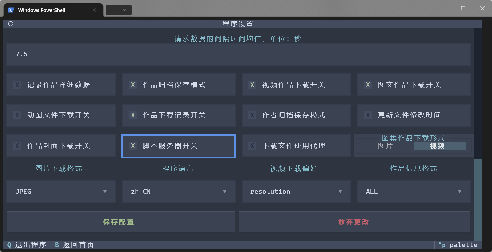
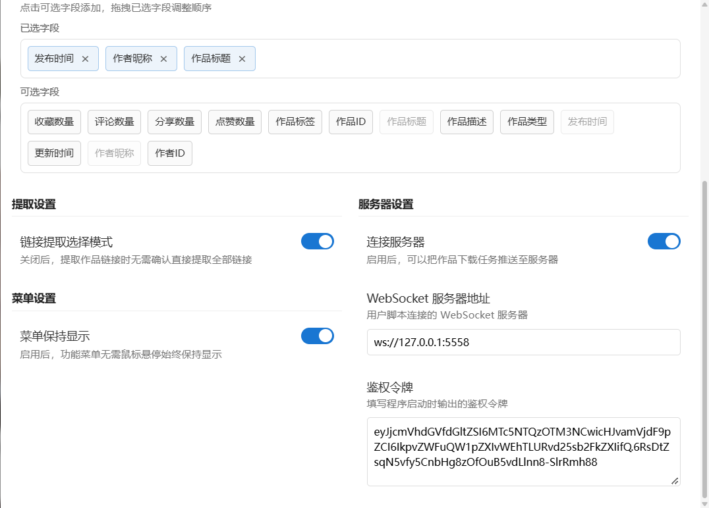
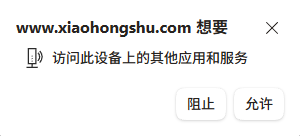
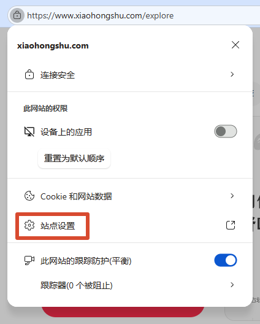
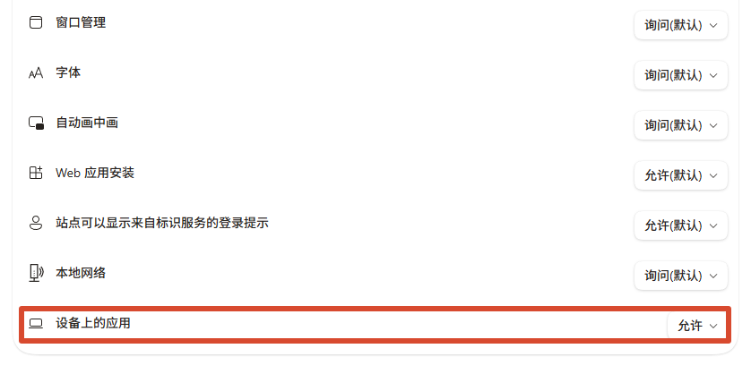
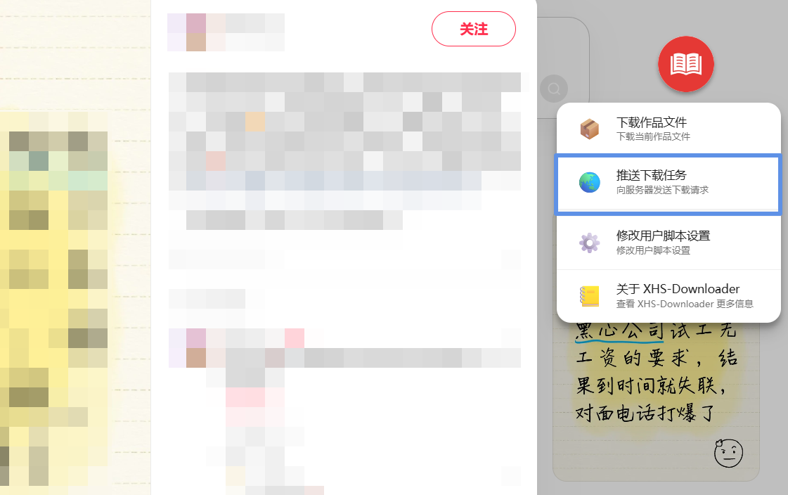
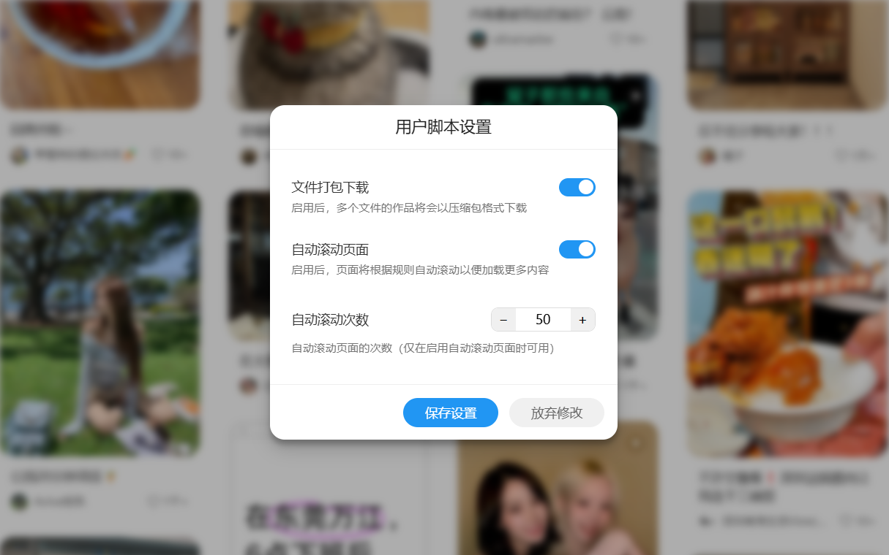

# 用户脚本与程序联动下载教程

**目标：** 在浏览器中通过 Tampermonkey 用户脚本，把当前小红书作品的下载任务一键推送到 XHS-Downloader 程序，由程序统一完成下载、命名和归档。

**版本要求：** 项目程序 **V2.9+**；用户脚本 **V2.5.8+**。

**联动下载的特点：**

- **可见即可得**：用户脚本读取的是当前浏览器页面已经加载出来的作品数据；页面上能看到的作品，就可以直接推送下载。
- **避免程序获取数据失败**：程序直接使用用户脚本传来的当前页面数据，不需要再次请求作品页，因此不会因为访问失败、链接过期或
  Cookie 缺失而拿不到作品数据。
- **统一管理**：文件命名、图片格式、保存位置、归档方式和下载记录都由程序统一处理。
- **后台下载**：任务推送成功后，下载在程序后台完成。

## 0. 联动下载是怎么工作的

联动下载由两部分组成：

- **用户脚本**：运行在小红书网页中，负责读取当前作品页面数据、可以选择需要下载的图片，并把下载任务发送出去。
- **项目程序**：运行在本机或远程服务器上，负责真正下载文件，并使用程序配置文件中的图片格式、文件命名、归档方式等设置。

两者通过 WebSocket 通信，默认地址为 `ws://127.0.0.1:5558`。

```text
小红书作品页（Tampermonkey 用户脚本）
        |
        |  WebSocket  ws://127.0.0.1:5558
        |  携带鉴权令牌 + 当前作品数据
        v
XHS-Downloader 项目程序（服务器）
        |
        |  使用程序配置下载
        v
Volume/Download（或自定义下载目录）
```

用户脚本读取当前页面已经加载的作品数据，并把这份数据随任务一起发送给程序，程序直接使用这份数据完成下载，不需要再次请求作品页。

## 1. 准备工作

### 1.1 准备项目程序

下载程序：

- 正式版（Releases）：<https://github.com/JoeanAmier/XHS-Downloader/releases/latest>
- 开发版（GitHub
  Actions）：<https://github.com/JoeanAmier/XHS-Downloader/actions/workflows/Manually_build_executable_programs.yml>

本教程以 Windows 可执行文件为准。程序启动方式：

- GUI模式：双击 `XHS-Downloader-GUI.exe`。
- TUI模式：在程序目录打开 PowerShell，运行 `.\XHS-Downloader.exe TUI`。

### 1.2 安装 Tampermonkey

Tampermonkey 官网地址：<https://www.tampermonkey.net/>

安装步骤：

1. 根据所用浏览器，从上述官方地址安装 Tampermonkey。
2. 安装完成后，在浏览器工具栏中确认 Tampermonkey 图标已出现，并保持扩展启用。

### 1.3 允许 Tampermonkey 运行用户脚本

Tampermonkey 5.3 及以上版本在 Chrome、Edge 等 Chrome 内核浏览器中，需要开启 **允许运行用户脚本** 或 **开发者模式**
任意一个开关才能运行用户脚本；未开启时，通过 Tampermonkey 安装的任何用户脚本都无法运行。这是 Tampermonkey
扩展本身受浏览器策略限制，不是本项目的特殊要求。

Tampermonkey 官方说明：<https://www.tampermonkey.net/faq.php?q=Q209>

**方式一：开启「允许运行用户脚本」（Chrome 138 及以上）**

1. 在地址栏输入 `chrome://extensions`（Edge 为 `edge://extensions`）并回车，打开扩展程序管理页面。
2. 在扩展列表中点击 Tampermonkey 卡片上的 **详情**，进入扩展详情页。
3. 开启 **允许运行用户脚本** 开关。

**方式二：开启「开发者模式」（Chrome / Edge）**

1. 在地址栏输入 `chrome://extensions`（Edge 为 `edge://extensions`）并回车，打开扩展程序管理页面。
2. 打开页面右上角的 **开发者模式** 开关。

### 1.4 安装用户脚本

用户脚本地址：

`https://cdn.jsdelivr.net/gh/JoeanAmier/XHS-Downloader@master/static/XHS-Downloader.js`

1. 复制上述地址。
2. 点击浏览器工具栏中的 Tampermonkey 图标，打开 **管理面板**。
3. 切换到 **实用工具**，找到 **从 URL 安装**。
4. 粘贴该地址，点击 **安装**。
5. 在安装页面中再次点击 **安装**。



*图 1：在 Tampermonkey 的“实用工具 → 从 URL 安装”中粘贴用户脚本链接*



*图 2：用户脚本的悬浮图标和菜单示例。不同页面的菜单项不同，作品详情页才会出现“推送下载任务”*

## 2. 开启程序的服务器模式

目的：让程序在后台开启服务器模式，等待用户脚本推送任务。

服务器模式默认关闭，必须先开启，用户脚本才能连接程序。

### 2.1 GUI 模式（推荐）

1. 双击 `XHS-Downloader-GUI.exe` 启动 GUI。
2. 点击左侧导航栏中的 **程序设置**。
3. 切换到 **通用设置**。
4. 找到 **脚本服务器开关**，将它打开。
5. 点击页面右上角的 **保存配置**。
6. 保持程序运行，不要关闭窗口。最小化窗口不会停止服务，关闭窗口才会退出程序。



*图 3：GUI「程序设置 → 通用设置」中的「脚本服务器开关」*

### 2.2 TUI 模式

1. 在程序目录打开 PowerShell，运行 `.\XHS-Downloader.exe TUI`。
2. 在主界面点击 **程序设置**。
3. 找到 **脚本服务器开关**，勾选它。
4. 点击 **保存配置**。
5. 保持程序运行。关闭终端或按 `Ctrl + C` 会退出程序，服务器也会随之停止。



*图 4：TUI「程序设置」中的「脚本服务器开关」*

## 3. 获取鉴权令牌

目的：获取服务器校验推送任务所用的鉴权令牌。

1. 打开程序所在目录。
2. 在文件夹地址栏输入 `powershell` 并回车；也可以在文件夹空白处按住 Shift 并右键，选择“在此处打开 PowerShell 窗口”或“在终端中打开”。
3. 运行 `.\XHS-Downloader.exe token`。

4. 终端会输出类似下面的内容：

```text
鉴权令牌: eyJjcmVhdGVfdGltZSI6....xxxxxxxx
```

5. 复制整段令牌。

令牌说明：

- 双击 `XHS-Downloader-GUI.exe` 启动 GUI 时不会显示令牌，需要按上面的方式单独执行 `token` 命令。
- 直接整段复制令牌，不要手动输入。
- 脚本保存设置时会自动去掉空白字符，粘贴时不需要刻意删除换行。
- 令牌与 `Volume/auth_secret.key` 文件绑定。删除该文件后，之前生成的令牌会全部失效，需要重新获取并更新到用户脚本中。
- 令牌默认永久有效，请勿公开或分享给他人。

## 4. 配置用户脚本连接

目的：配置用户脚本与程序的连接及鉴权信息。

1. 打开小红书页面。
2. 将鼠标移到页面右侧的红色悬浮图标上，展开菜单。
3. 点击 **修改用户脚本设置**。
4. 找到 **服务器设置** 区域。
5. 打开 **连接服务器** 开关。
6. **WebSocket 服务器地址** 使用默认值 `ws://127.0.0.1:5558`，无需修改。
7. 在 **鉴权令牌** 中粘贴之前复制的令牌。
8. 点击 **保存设置**。



*图 5：用户脚本的“修改用户脚本设置”界面，服务器设置位于弹窗中*

保存设置后，用户脚本会立即尝试连接程序。

## 5. 允许浏览器访问本机服务

目的：允许网页连接本机程序，避免浏览器拦截本地 WebSocket 请求。

用户脚本尝试连接程序时，Chrome 可能会弹出权限提示：

> **[www.xiaohongshu.com](http://www.xiaohongshu.com) 想要访问此设备上的其他应用和服务**

出现提示时，请选择 **允许**。



*图 6：Chrome 的“设备上的应用”权限提示，选择“允许”*

浏览器会记住你的选择，用户脚本无法强制再次弹出提示。如果之前选择了“禁止”，或者没有出现提示，可以手动修改：

1. 打开小红书页面。
2. 点击地址栏左侧的网站图标。
3. 点击 **站点设置**（部分浏览器显示为 **网站设置**）。



*图 7：点击地址栏左侧网站图标，再点击“站点设置/网站设置”*

4. 找到 **设备上的应用**，将其设置为 **允许**。



*图 8：将“设备上的应用”设置为“允许”*

5. 回到小红书页面并刷新。

## 6. 推送下载任务

目的：将当前作品的数据发送给程序，由程序完成下载。

1. 打开一个小红书作品详情页。
2. 将鼠标移到页面右侧的红色悬浮图标上，展开菜单。
3. 确认菜单中出现 **推送下载任务**。这个菜单项只有在“连接服务器”开启时才会显示。



*图 9：作品详情页悬浮菜单中的「推送下载任务」*

4. 点击 **推送下载任务**。
5. 如果当前是图文或图集作品、包含多张图片，并且“图片下载选择模式”处于开启状态，脚本会弹出图片选择窗口。选中需要的图片后，点击
   **开始下载**。



*图 10：图文作品推送时，可以选择需要下载的图片*

6. 页面会提示 **下载任务已接收**。这表示程序已经收到任务，不代表文件已经下载完成。

注意事项：

- 推送到程序的下载任务，所有设置均以程序端为准。
- 推送成功并看到“下载任务已接收”后，可以关闭当前作品页面，程序会在后台继续下载。

## 7. 在程序中查看下载结果

推送成功后，任务会出现在程序端。程序会把任务放入队列并按顺序处理，连续推送多个作品时，后面的任务会等待前面的任务完成。不同界面的查看方式如下。

- **GUI 模式**：在 **任务队列** 中查看任务状态，在 **运行日志** 中查看文件下载、跳过、失败等详细日志。
- **TUI 模式**：在主界面的日志区域查看文件下载结果。

## 8. 设置优先级：哪些设置听脚本，哪些听程序？

推送下载任务时，与文件相关的设置均以 **程序端**为准；用户脚本中的对应设置只影响脚本在浏览器中直接下载。

| 设置项                      | 脚本直接下载 | 推送到程序 |
|-----------------------------|--------------|------------|
| 选择哪些图片                | 脚本设置     | 脚本设置   |
| 图片下载格式                | 脚本设置     | 程序设置   |
| 视频下载质量                | 脚本设置     | 程序设置   |
| 作品文件名称                | 脚本设置     | 程序设置   |
| 图集下载形式                | 脚本设置     | 程序设置   |
| 文件打包下载                | 脚本设置     | 不涉及     |
| 下载目录 / 归档方式         | 不涉及       | 程序设置   |
| 下载记录 / 跳过重复         | 不涉及       | 程序设置   |
| Cookie / 代理 / 超时 / 重试 | 不涉及       | 程序设置   |

## 9. 常见问题

### Q1：菜单里没有“推送下载任务”怎么办？

按顺序检查：

1. 用户脚本设置中的 **连接服务器** 是否已经打开。
2. 当前页面是否为作品详情页；账号主页、搜索页不会显示该菜单项。

### Q2：提示“脚本服务器连接失败，请检查网络连接、服务器地址、服务器状态或浏览器的网站设置”怎么办？

按顺序检查：

1. 程序是否正在运行，且没有关闭窗口。
2. 程序设置中的 **脚本服务器开关** 是否已经打开并保存。
3. 浏览器是否已经允许“设备上的应用”权限。
4. 是否开启了全局代理或网络加速工具；尝试将 `127.0.0.1` 和 `localhost` 加入直连，或暂时关闭代理。
5. 是否有其他程序占用了 `5558` 端口。

### Q3：提示“脚本服务器未连接，正在重连并推送任务...”怎么办？

这通常是因为先打开了网页、后启动程序，脚本正在尝试重连。

1. 确认程序已经启动，并且服务器模式已经开启。
2. 等待几秒，脚本会自动重连并发送待推送的任务；如果仍未成功，再点击一次“推送下载任务”。
3. 如果仍然失败，刷新小红书页面，或者重新打开用户脚本设置并点击“保存设置”。
4. 仍然无法连接时，按 Q2 继续排查。

### Q4：提示“鉴权令牌无效或已过期”怎么办？

1. 重新运行 `.\XHS-Downloader.exe token`，复制完整的令牌。
2. 在用户脚本设置中清空旧令牌，重新粘贴新令牌，点击“保存设置”。
3. 如果删除 `Volume/auth_secret.key`，旧令牌会全部失效，必须使用新生成的令牌。

### Q5：浏览器没有弹出权限提示，或者之前点了“禁止”怎么办？

1. 打开小红书页面。
2. 点击地址栏左侧的网站图标，进入 **站点设置 / 网站设置**。
3. 找到 **设备上的应用**，改为 **允许**。
4. 回到页面并刷新。

### Q6：页面提示“下载任务已接收”，但程序没有下载文件怎么办？

1. 打开程序的 **任务队列** 或 **运行日志**，确认任务状态。
2. 检查程序是否关闭了对应的图片/视频下载开关。
3. 如果提示“作品存在下载记录，跳过处理”，删除下载记录后重试。
4. 如果任务状态为失败，日志中会显示具体错误信息。

### Q7：端口 5558 被占用怎么办？

1. 在 Windows 终端中运行 `netstat -ano | findstr :5558` 检查端口占用。
2. 如果输出中出现 `LISTENING` 行，说明端口正被某个程序监听，行末的数字就是该程序的 PID（进程 ID）：

```text
  TCP    0.0.0.0:5558           0.0.0.0:0              LISTENING       23148
```

3. 运行 `tasklist /FI "PID eq 23148"` 查询对应的进程名称。
4. 关闭占用端口的程序；无法正常关闭时，在终端中执行 `taskkill /PID 23148 /F` 强制结束，然后重新启动 XHS-Downloader。
5. 如果 `tasklist` 提示没有匹配的进程，说明占用端口的程序已经退出，端口已释放，直接启动 XHS-Downloader 即可。

### Q8：必须登录小红书账号吗？

没有要求，脚本遵循“可见即可得”：页面上能正常看到的内容可以推送下载；如果作品因未登录而无法查看，也就无法下载。
